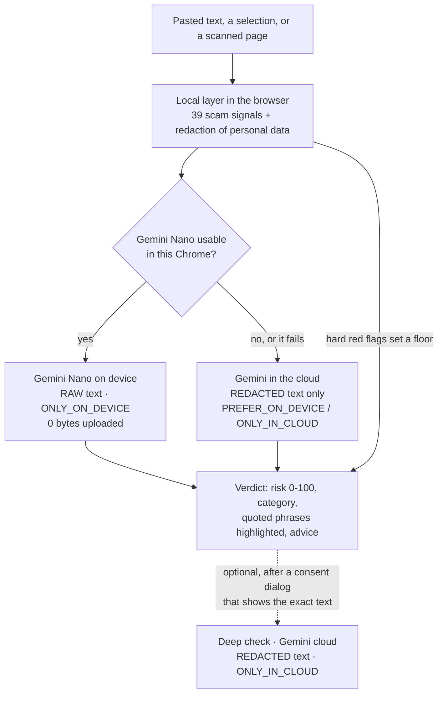

# Scam Shield

**Is it a scam? Ask your own computer.** Scam Shield checks messages, job offers, e-mails and web pages with Gemini Nano running inside Chrome, so the raw text never leaves your PC. When Nano is not available, only a redacted copy goes to Gemini in the cloud.

**Live app:** https://scamshield-hybrid.web.app · **Chrome extension:** [`scam-shield-extension.zip`](https://github.com/VladimirRadev/scam-shield/releases/latest) · Licence: Apache-2.0

## The problem

Scams now arrive as fake recruiters who send a "take-home task" repository that installs malware, "wallet support" agents who ask for your seed phrase, parcel fees of €1.99, and supplier e-mails with new bank details. People who are unsure paste these messages into a cloud chatbot to ask "is this real?". In doing so they upload names, phone numbers, IBANs, addresses and sometimes their recovery phrase to yet another server.

## How it works

1. **Local layer, in the browser, instant:** 39 deterministic scam signals (seed-phrase requests, `npm install` from a stranger's repo, Win+R "CAPTCHA" commands, look-alike domains, gift cards, urgency...) and redaction of personal data: e-mails, phones, IBANs (any letter case, checksum-verified), card numbers and CVV codes, private keys (hex, WIF, `xprv`, Solana), crypto addresses, recovery phrases (also misspelt, numbered or dash-separated), street addresses, SSNs and passport numbers, dates of birth, one-time codes, social handles, names (greetings, sign-offs, titles such as "Dr."; any script), and links reduced to their domain.
2. **Gemini Nano on the device** reads the **raw** text through Firebase AI Logic with `InferenceMode.ONLY_ON_DEVICE`. Nothing is uploaded. The SDK builds its on-device adapter only when Chrome's Prompt API (`LanguageModel`) exists, and without it even an `ONLY_ON_DEVICE` model would call the cloud, so Scam Shield refuses the raw-text call before the SDK is reached unless `LanguageModel` exists and Nano reports "available".
3. **Cloud fallback with redacted text only:** if Nano is not installed, not supported, fails to start, or does not answer in time (60 s to open the session, 120 s for the first answer, 90 s for each later answer; Chrome's CPU backend needs about 30 s per check), the **redacted** text goes to Gemini in the cloud.
4. **Deep check (optional):** a slower cloud check, sent only after a consent dialog that shows the exact redacted text and its size.

The final risk is `max(model, hard-sign floor, average(model, heuristics))`, and any high-severity sign, or a heuristic total at the suspicious threshold, keeps it at least "suspicious". A fooled or prompt-injected model ("risk 0, safe") therefore cannot turn a message with red flags into "safe": with a model that always answers "safe", 0 of the 30 scam examples end as safe and no legitimate example changes its verdict. When this happens, the result says "The AI's answer was overruled by local red flags" and shows the built-in advice instead of the model's.

**Corroboration rule: the model alone cannot call a message a scam.** When no local red flag fired (no high-severity sign and a heuristic total under 40), a model risk under `model_only_min_risk` (85, Remote Config) leaves the message "safe", and a higher one makes it at most "suspicious". The card then says "Gemini Nano raised a concern, but no local red flag confirmed it" and lists the model's notes as hints. The rule exists because of a measurement: on the CPU-only Gemini Nano of [run 45965556713](https://github.com/VladimirRadev/scam-shield/actions/runs/45965556713), 13 of the 20 legitimate examples came out at least "suspicious" (a requested one-time code at 90, a DHL notice at 70), while the heuristics alone flagged all 30 scams and none of the legitimate examples. Replaying the 50 recorded Nano answers through the new engine (`npm run replay:nano`) leaves 1 false alarm instead of 13 (the one-time code, now "suspicious"), 0 legitimate messages called "scam" instead of 2, and all 30 scams caught; the examples were written together with the heuristics, so this is optimistic. The cost: a scam with no local sign at all now reaches at most "suspicious". Prompt v2 also tells the model that one-time codes, shipping updates, bills, reminders and colleagues' requests are normally safe without a concrete harmful ask. The device table below is from prompt v1 without the rule and will be refreshed after the next CI run.



### Where your text goes

| Situation | Model | Firebase AI Logic mode | What the model sees | Leaves your device |
|---|---|---|---|---|
| Gemini Nano ready | Gemini Nano in Chrome | `ONLY_ON_DEVICE` | raw text | nothing |
| Nano not installed, or not Chrome desktop | Gemini cloud (`gemini-3.5-flash-lite`) | `PREFER_ON_DEVICE` (falls to cloud) | redacted text | redacted text, about 2 kB |
| Nano says "available" but cannot run (no usable GPU), fails, or times out | Gemini cloud | `ONLY_IN_CLOUD` | redacted text | redacted text, about 2 kB |
| Deep check, after consent | Gemini cloud, more thinking | `ONLY_IN_CLOUD` | redacted text, shown first | redacted text |
| Cloud call sent but failed (HTTP error, blocked or unreadable answer, network error, timeout) | none answered | as above | redacted text | redacted text (shown as sent; verdict from local signals) |
| Firebase not configured, or the call refused before any request | none | none | none | nothing (local signals only) |
| Community counters | Firestore | none | none | four counter names, each `+1`; no text, no URL, no user id |

Every result shows where it ran, how long it took and how many bytes were sent (for example *On-device Gemini Nano · 840 ms · 0 bytes sent*). The byte count also covers a cloud call that failed after the request was issued, so such a check never reads "nothing sent" and is counted on the cloud route in the community counters. Raw text can only reach the model through the `ONLY_ON_DEVICE` instance, only after the pre-flight check above, and a privacy assertion throws if that call ever reports a cloud `inferenceSource`.

## Firebase AI Logic: the exact calls

| Call | Where |
|---|---|
| `getAI(app, { backend: new GoogleAIBackend() })` (Gemini Developer API) | [`packages/ai/src/firebase.ts`](packages/ai/src/firebase.ts) |
| `getGenerativeModel(ai, { mode: InferenceMode.PREFER_ON_DEVICE, onDeviceParams, inCloudParams })` quick check | [`packages/ai/src/models.ts`](packages/ai/src/models.ts) |
| `getGenerativeModel(ai, { mode: InferenceMode.ONLY_ON_DEVICE, ... })` the only model that receives raw text | [`packages/ai/src/models.ts`](packages/ai/src/models.ts) |
| `getGenerativeModel(ai, { mode: InferenceMode.ONLY_IN_CLOUD, ... })` cloud fallback and deep check (`thinkingLevel` LOW / MEDIUM) | [`packages/ai/src/models.ts`](packages/ai/src/models.ts) |
| `onDeviceParams.promptOptions.responseConstraint = VERDICT_JSON_SCHEMA` (structured output from Nano) | [`packages/ai/src/models.ts`](packages/ai/src/models.ts), schema in [`packages/core/src/prompt.ts`](packages/core/src/prompt.ts) |
| `inCloudParams.generationConfig.responseJsonSchema = VERDICT_JSON_SCHEMA` (same schema in the cloud) | [`packages/ai/src/models.ts`](packages/ai/src/models.ts) |
| `result.response.inferenceSource` (`on_device` / `in_cloud`) decides the provenance chip and guards the raw-text route | [`packages/ai/src/models.ts`](packages/ai/src/models.ts) |
| `model.initializeDeviceModel()` and `LanguageModel.availability()` / `create()` for the Nano download and a real start-up probe | [`packages/ai/src/index.ts`](packages/ai/src/index.ts), [`packages/ai/src/on-device.ts`](packages/ai/src/on-device.ts) |

The routing rule itself (raw text only on device, redacted text otherwise) lives in the pure, unit-tested engine: [`packages/core/src/engine.ts`](packages/core/src/engine.ts).

## Other Firebase products

| Product | Why |
|---|---|
| **App Check** | Every request carries an App Check token: reCAPTCHA Enterprise on the web app, a registered debug token in local development and in the extension (an MV3 extension may not load the reCAPTCHA script). Enforcement is on for Cloud Firestore and in monitoring mode for Firebase AI Logic (the console offers no enforce switch for AI Logic on this project yet). A build guard, also run as the Hosting `predeploy`, fails `npm run build` if the configured debug token, or any UUID assigned to an App Check debug-token variable, appears in `apps/web/dist`. |
| **Anonymous Auth** | Every visitor gets an anonymous user, with no sign-up and no personal data. Firestore rules accept only signed-in requests. |
| **Remote Config** | Tune without a redeploy: `risk_threshold_scam` (70), `risk_threshold_suspicious` (40), `model_only_min_risk` (85, the corroboration rule), `cloud_model` (`gemini-3.5-flash-lite`), `deep_check_enabled` (kill switch for the cloud deep check), `prompt_version` (`v2`). Defaults are in code, so the app works if the fetch fails. |
| **Cloud Firestore** (Lite SDK, loaded lazily) | Anonymous community counters in one document `stats/global`: "1,284 checks so far · 71% never left the device". [`firestore.rules`](firestore.rules) allow only `+1` on known counter fields (`checks`, one route, one verdict, one category per check), so no text can ever be stored. 10 rules tests run on the emulator. |
| **Hosting** | https://scamshield-hybrid.web.app |

## Evaluation

50 labelled synthetic messages ([`packages/core/src/examples.json`](packages/core/src/examples.json)): 30 scams across 11 families and 20 legitimate look-alikes (real recruiter outreach, an honest take-home task, a colleague's code-review request, genuine invoices and delivery notices).

**Heuristic layer only** (`npm run eval`), thresholds suspicious ≥ 40, scam ≥ 70:

| Positive when | TP | FP | FN | TN | Precision | Recall | F1 |
|---|---:|---:|---:|---:|---:|---:|---:|
| flagged (risk >= 40) | 30 | 0 | 0 | 20 | 100.0% | 100.0% | 100.0% |
| scam (risk >= 70) | 15 | 0 | 15 | 20 | 100.0% | 50.0% | 66.7% |

The heuristics alone flag every scam but call only half of them a clear "scam"; the model layer supplies the confidence.

**Real models in the browser** ([`apps/web/eval.html`](apps/web/eval.html), open `/eval.html` on the hosted app): every example runs through the real engine on one fixed route, one after another; the page reports precision / recall / F1, median and p90 latency and the average bytes sent off the device.

**Gemini Nano on device, raw text (ONLY_ON_DEVICE)**, 50 examples (Chrome 157, prompt v2, [CI run 45973514997](https://github.com/VladimirRadev/scam-shield/actions/runs/45973514997), 2026-11-27)

| Positive when | TP | FP | FN | TN | Precision | Recall | F1 |
|---|---:|---:|---:|---:|---:|---:|---:|
| flagged (risk >= 40) | 30 | 0 | 0 | 20 | 100.0% | 100.0% | 100.0% |
| scam (risk >= 70) | 27 | 0 | 3 | 20 | 100.0% | 90.0% | 94.7% |

Latency per check: median 28,808 ms, p90 33,044 ms (2-core CPU, no GPU) · average sent off the device: 0 bytes · answered by: 50 on-device · no misclassified examples.

**Cloud, redacted text (ONLY_IN_CLOUD, gemini-3.5-flash-lite)**, 50 examples (Chrome 158, prompt v2, live app, 2026-11-27)

| Positive when | TP | FP | FN | TN | Precision | Recall | F1 |
|---|---:|---:|---:|---:|---:|---:|---:|
| flagged (risk >= 40) | 30 | 0 | 0 | 20 | 100.0% | 100.0% | 100.0% |
| scam (risk >= 70) | 30 | 0 | 0 | 20 | 100.0% | 100.0% | 100.0% |

Latency per check: median 1,296 ms, p90 1,778 ms · average sent off the device: 2.5 kB (redacted) · answered by: 50 cloud-redacted · no misclassified examples.

**Before calibration** (prompt v1, no corroboration rule, [CI run 45965556713](https://github.com/VladimirRadev/scam-shield/actions/runs/45965556713)), the same on-device route flagged 13 of the 20 legitimate look-alikes (precision 69.8%): the small on-device model leans towards caution. That measurement is why prompt v2 describes normal transactional messages and why the engine now needs a local red flag (or a model risk ≥ 85) before a model-only concern becomes "suspicious". `npm run replay:nano` replays the recorded v1 answers through the current engine (13 → 1 false alarm).

These examples are synthetic and were written alongside the heuristics, so the numbers are optimistic; they show that the pipeline works end to end on real models, not real-world accuracy.

### On-device evidence

The device route was measured with real Chrome and real Gemini Nano on a GitHub-hosted runner. The workflow [`on-device-e2e.yml`](.github/workflows/on-device-e2e.yml) starts headful Google Chrome on `windows-latest`, and [`scripts/ci/on-device-e2e.mjs`](scripts/ci/on-device-e2e.mjs) drives the hosted app over the Chrome DevTools protocol: it lets Chrome download Gemini Nano, sends one smoke prompt, clicks **Run on device** on `/eval.html` for all 50 examples, and takes screenshots of three checks in the app. Results of [run 45973514997](https://github.com/VladimirRadev/scam-shield/actions/runs/45973514997) (27 Nov 2026), the device table above:

| | Measured |
|---|---|
| Runner | AMD EPYC 9V74 (2 cores, 4 threads), 16 GiB RAM, Windows Server 2025, no GPU |
| Chrome | 157.0.8103.79 |
| Model | Gemini Nano `nano_v3_cpu` 2025.8.21.1028 (2,730 MiB), CPU backend: `chrome://on-device-internals` reports performance class "GpuBlocked" and "Device Capable: true" |
| Download | 115 s, from "downloadable" to a working session |
| Smoke prompt (Prompt API directly) | first answer 2.8 s, second answer 1.8 s |
| Scam Shield checks | 50 of 50 answered on the device, 0 bytes sent; median 28.8 s and p90 33.0 s per check (a ~2.3 k-character prompt with a JSON response constraint on a 2-core CPU) |
| App screenshots | recruiter "clone our repo" → Scam · *On-device Gemini Nano · 32 s · 0 bytes sent*; seed-phrase "support" → Scam · 26 s; genuine recruiter → Looks safe · 35 s |

The screenshots, the screen recording used in the demo video, the full `chrome://on-device-internals` dumps and the per-call timings are the run's artifacts.

## Try it

- **Web:** open https://scamshield-hybrid.web.app, pick an example chip or paste a message, press **Check privately**.
- **Chrome extension:** download `scam-shield-extension.zip` from the [latest GitHub Release](https://github.com/VladimirRadev/scam-shield/releases/latest), unzip it, open `chrome://extensions`, switch on **Developer mode**, click **Load unpacked** and choose the unzipped folder. Then right-click any selection → **Check with Scam Shield**, or open the side panel and click **Scan this page**.
  The extension needs no Firebase allow-list entry: anonymous Auth, the App Check debug-token exchange, Remote Config, Firestore and Firebase AI Logic all answer the `chrome-extension://` origin (CORS checked on 2026-11-27). If the API key is ever restricted by HTTP referrer, add `chrome-extension://<extension id>/*` to it.
- **Gemini Nano:** needs desktop Chrome 139 or newer (Windows, macOS or Linux) and about 22 GB of free disk space. The model downloads on first use: click **Install** in the status panel. Until it is ready, the app keeps working with redacted cloud checks, and the status panel says so.

## Local development

```bash
npm ci
cp .env.example .env.local     # fill in the Firebase web config (and optionally an App Check debug token)
npm run dev                    # web app on http://localhost:5173 (eval page: /eval.html)
npm test                       # unit tests (Vitest)
npm run test:rules             # Firestore rules tests on the emulator (needs the Firebase CLI and Java 21+)
npm run eval                   # heuristic evaluation table
npm run build                  # typecheck + production web build + debug-token guard
npm run build:ext              # extension into apps/extension/dist
npm run zip:ext                # ... and scam-shield-extension.zip
```

Layout: `packages/core` (pure TypeScript: redaction, signals, prompt and JSON schema, engine, metrics), `packages/ai` (Firebase: App Check, Auth, Remote Config, Firestore counters, AI Logic models), `packages/ui` (shared React UI), `apps/web` (hosted app and eval page), `apps/extension` (MV3 side panel and context menu).

## Limitations

- The evaluation set is synthetic and was written together with the heuristics, so the heuristic numbers are optimistic.
- English only: the on-device session is created for English input and output.
- Gemini Nano needs desktop Chrome, capable hardware and about 22 GB of free disk; on other devices every model check is a redacted cloud check.
- Redaction is pattern-based. It can miss names that appear without a greeting, sign-off, title or "name:" label, addresses in unusual formats, and bare links whose top-level domain is not in its list (for example `mybank.lt/login`); that is why the deep check shows the exact text before anything is sent. A run of 10-15 digits is masked as a phone number unless a shipment, order or invoice word comes right before it.
- The red-flag floor guarantees at least "suspicious" for a message with a strong local sign, not "scam": a fooled model can still lower the confidence.
- The extension build carries an App Check debug token (MV3 cannot load reCAPTCHA); anyone with the zip could extract it, so it should be rotated after judging.
- The community counters are best effort and live in one Firestore document (about one write per second sustained).

## Built with

Firebase AI Logic (hybrid inference), Gemini Nano in Chrome, Gemini Developer API, App Check, Anonymous Auth, Remote Config, Cloud Firestore, Firebase Hosting, React, Vite, TypeScript, Vitest.

Built solo with Claude Code (Anthropic) as the AI coding assistant.

## Licence

[Apache-2.0](LICENSE)
